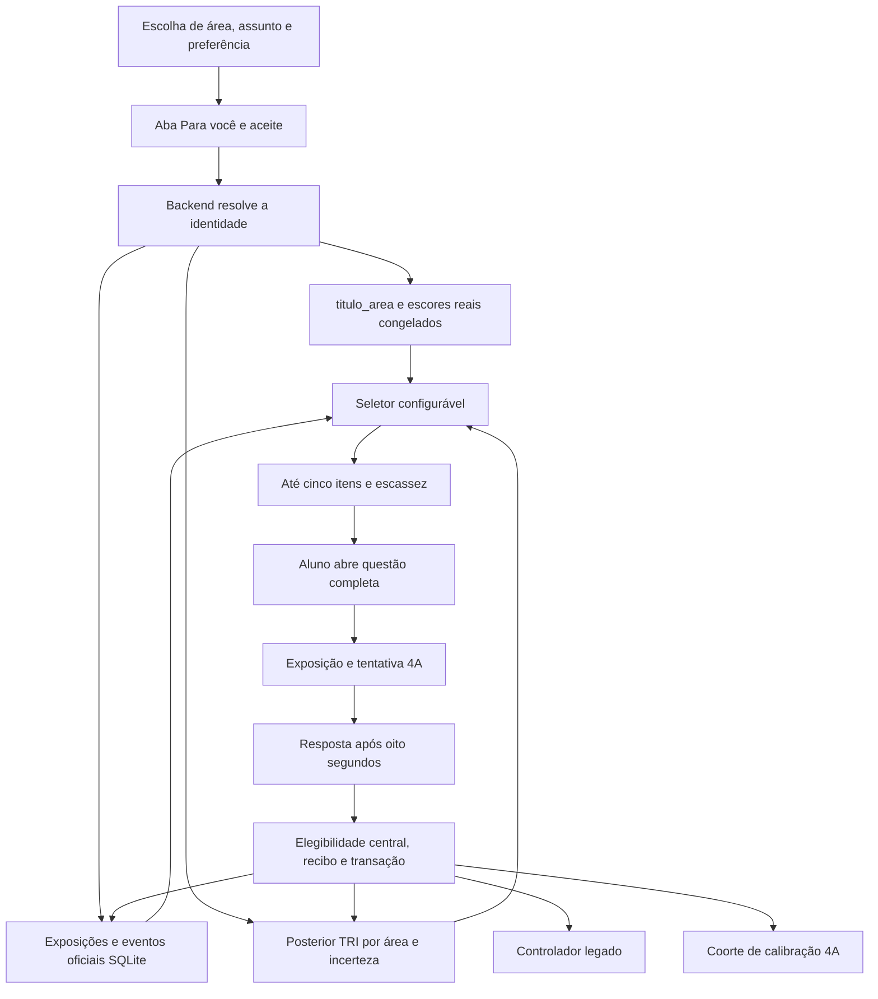

# Arquitetura implementada e natureza da IA

| Componente | Natureza verificável |
|---|---|
| Encoders semânticos | Pré-treinados; vetores existentes preservados, nenhum fine-tuning nesta fase |
| TF-IDF | Vocabulário e IDF previamente ajustados no treino, conforme índice |
| titulo_area | Recuperação por metadados, vetores, RRF e sinais; inferência da rotina original |
| TRI | 3PL e posterior individual atualizado por respostas elegíveis |
| Prior/tabela de nota | Configuração herdada, não reajustada nesta fase |
| Controlador | Atualização da janela/meta existente, protegida pela integridade 4A |
| Seletor 4B | Ponderação e regras heurísticas, sem treinamento dos pesos |
| Cache de escores | Resultado real de inferência, não um modelo novo |

Atualizar o posterior individual não é treinar globalmente a/b/c. A presença de vetores
não comprova treinamento de encoder pelo grupo. Pesos heurísticos não são aprendizado
contínuo dos pesos. Não há gerador de texto ou chamada remota de LLM no runtime.
O semântico herdado inclui vetores Qwen3-Embedding: essa procedência deve ser informada
na discussão dos requisitos acadêmicos.

O adaptador novo lê o catálogo do Ítalo e preserva sua pontuação e posição. Não o edita.
TRI estima proficiência por área, sem certificar domínio por assunto. Preferências não
são trocadas sem aceite. A calibração preserva somente a coorte 4A; nenhuma avaliação
estatística da Fase 5 foi executada. Os percursos legados continuam disponíveis.

A integração é funcional e rastreável. Validação pedagógica e estatística permanecem pendentes.
