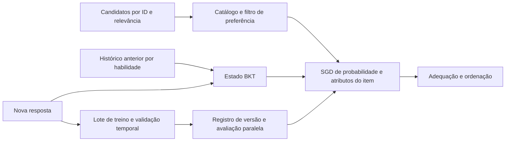

# Encerramento técnico da Fase 2 · Gabaritei PI VI

**Decisão: APROVADA COM RESSALVAS NÃO BLOQUEANTES para orientar a implementação da Fase 3.** A arquitetura principal é **BKT ajustado + regressão logística SGD treinável**, inicialmente com parâmetros congelados em serviço. O estado do aluno pode mudar a cada resposta. Novos parâmetros devem começar em avaliação paralela. A contingência é **SGD isolado** com contagem de oportunidades e taxa de acerto suavizada por habilidade. Nenhuma dessas versões está validada para produção no ENEM.

## Auditoria e correções

Preservamos `experimento.py`, `resultados.json` e os artefatos das rodadas anteriores. O ajuste da dificuldade de itens, o truncamento e a origem das representações estão documentados no relatório de viabilidade e nos resultados históricos incluídos. Confirmamos no código original que a previsão BKT e os atributos do SGD derivam somente de respostas anteriores do mesmo aluno e habilidade. O `partial_fit` usa alunos separados da avaliação. A ordenação original por `order_id` garante sequência por aluno, mas a separação aleatória permitia sobreposição de períodos entre papéis. Isso limita a alegação de generalização temporal. Também havia retenção arbitrária do primeiro registro em caso de duplicata. A nova rodada exclui chaves com habilidade ou acerto conflitante antes de deduplicar. Ela usa grupos disjuntos por aluno e janelas globais estritamente sucessivas em ordem de evento, com empates mantidos numa janela. O recorte mudou, portanto os valores antigos e novos não formam um teste pareado entre rodadas.

| Janela | Alunos | Eventos |
|---|---:|---:|
| Treino | 297 | 13.905 |
| Atualização 1 | 123 | 3.950 |
| Validação da atualização 1 | 161 | 3.541 |
| Atualização 2 | 186 | 4.835 |
| Validação da atualização 2 | 218 | 3.578 |
| Avaliação posterior | 26 | 4.899 |

Os históricos começam na janela de cada aluno. O teste final foi usado para medir generalização posterior, após escolher taxas e versões nas janelas de validação. O estudo é pequeno em número de alunos independentes, especialmente no período final. O corte por ordem não mede duração real nem representa uma população ENEM. Resultados agregados por evento pesam mais alunos com históricos longos.

## Comparação em eventos posteriores

| Modelo | AUC | Log Loss ↓ | Brier ↓ | ECE ↓ |
|---|---:|---:|---:|---:|
| Constante de treino | 0,5000 | 0,6100 | 0,2094 | 0,0520 |
| BKT ajustado | 0,6006 | 0,5852 | 0,1980 | 0,0430 |
| SGD isolado congelado | **0,6185** | 0,5808 | 0,1962 | 0,0424 |
| SGD isolado após dois lotes selecionados | 0,6162 | 0,5834 | 0,1968 | 0,0437 |
| BKT + SGD congelado | 0,6174 | **0,5795** | **0,1956** | **0,0400** |
| BKT + SGD após dois lotes selecionados | 0,6126 | 0,5833 | 0,1968 | 0,0457 |

O híbrido é a escolha de arquitetura pelo estado interpretável de habilidade e pela qualidade probabilística ligeiramente melhor nesta amostra. A margem sobre SGD isolado é pequena e não estabelece superioridade estatística. O SGD isolado serve de contingência e baseline obrigatória. O BKT puro tem estado útil e parâmetros ajustados, mas sua transição individual não comprova que pesos foram atualizados. DKT foi adiado porque o objetivo é decidir um piloto com histórico ENEM ainda inexistente. Um treino DKT em ASSISTments ampliaria a comparação externa, sem resolver transferência de habilidade, necessidade de dados ou estabilidade no domínio.

## Política experimental e rollback

Cada lote gerou candidatos com taxa 0,0002, 0,002 ou 0,02 e uma variante que ajusta o intercepto em uma cauda temporal separada do lote. A regularização L2 ficou fixa em 0,001. A política exige redução de Log Loss, Brier sem piora e perda máxima de AUC de 0,005 na próxima janela. Entre candidatos elegíveis, escolhe o menor Log Loss. Cada candidato parte de uma cópia da versão vigente. Guardar a versão, os parâmetros, o lote, o resultado e a versão pai permite restaurar a última versão estável.

O híbrido selecionou taxa 0,02 no primeiro lote e 0,0002 no segundo. A taxa 0,02 no segundo lote foi rejeitada e posteriormente obteve Log Loss 0,5895. A variante calibrada do segundo lote também foi rejeitada. A versão selecionada mudou coeficientes e intercepto em norma L2 de 0,9056, deslocou probabilidades em 0,0331 em média absoluta e mudou 31 decisões no limiar 0,5. O deslocamento médio assinado foi +0,0190. No experimento anterior, AUC e Log Loss divergiram porque o primeiro mede ordenação e o segundo penaliza probabilidades mal atribuídas. Nesta rodada, nem o ajuste de intercepto nem o filtro de uma única janela garantiram ganho posterior. A prevalência foi 58,5% na segunda janela de validação e 70,8% no teste. Isso é evidência de mudança de distribuição, sem identificar a causa individual de cada erro.

Para implementação, manter o modelo congelado como versão servida, executar candidatos em paralelo e exigir validação em múltiplas janelas com quantidade mínima de alunos e monitoramento de calibração por área. Fixar as margens antes do piloto. Em caso de degradação, restaurar o identificador da versão pai sem apagar eventos. O teste automatizado confirma que gerar uma candidata preserva o snapshot anterior. Persistência, monitoramento e acionamento operacional de rollback ficam para etapas autorizadas.

## Habilidade, dificuldade e integração

O catálogo elegível tem 2.063 itens e 164 sem habilidade preenchida. Todos têm TRI e metadados pedagógicos marcados como gerados por regras e sem revisão. Sete itens têm `a < 0,25`. Usar chave composta `area:habilidade` apenas após conferir a associação com a matriz oficial. Quando o rótulo faltar, for escasso ou estiver sem validação, manter um estado por área e sinalizar granularidade reduzida. Assunto sugerido automaticamente serve como metadado auxiliar, sem status de habilidade oficial. Para estudante novo, iniciar pelo prior do grupo e manter a preferência escolhida.

Na TRI de três parâmetros, `a` é discriminação, `b` localiza o item na escala e `c` é a assíntota inferior. O valor `b` não é probabilidade individual. Para o futuro, testar `b` como atributo de item com sinal de disponibilidade, transformação ajustada no treino e análise de estabilidade de itens com baixa discriminação. Em itens sem TRI, manter a ausência explícita e usar a classe textual somente como fallback de catálogo, com origem e versão. A classe textual não deve ser tratada como estimativa contínua de `b`. Preservar a possibilidade de previsão apenas com histórico quando metadados faltarem.



**Contrato proposto.** Entrada de candidatos com `question_id`, `dataset_revision` e relevância opcional. O catálogo versionado resolve área, habilidade, dificuldade e fonte. O módulo recebe preferência, histórico pseudonimizado ordenado e IDs vistos. Rejeita revisão incompatível, filtra área e preferência explícita e devolve IDs, pontuação de adequação, probabilidade quando calibrada, origem dos metadados, versão do modelo e códigos de fallback. Sem candidato, devolve lista vazia e motivo. A origem dos candidatos é substituível. O README da branch de Ítalo documenta RRF TF-IDF + MiniLM, enquanto Qwen3-Embedding-8B é uma direção mencionada no projeto e um modelo de embeddings. A implantação do Qwen não foi verificada. O contrato funciona com busca lexical, lista local ou recomendador externo, sem dependência de LLM nem alteração do componente de Ítalo. [README do recomendador](https://github.com/italodsz/Gabaritei---PI-VI/blob/recomendador/recomendador/rrf-tfidf-minilm-J/README.md) · [Qwen3-Embedding-8B](https://huggingface.co/Qwen/Qwen3-Embedding-8B)

**Prova de conceito.** A integração executada usa seis itens ENEM reais com TRI e dois perfis inteiramente sintéticos. Para o primeiro item médio retornado em cada perfil, as pontuações probabilísticas passaram de 0,6961 para 0,7029 e de 0,2590 para 0,3237 após um novo acerto. Os perfis foram representados pela área MT, sem alegar equivalência com as habilidades do ASSISTments. A transformação fixa `−tanh(b/2)` nos log-odds é somente ilustrativa. O objetivo de adequação 0,70 também é demonstrativo. Os valores não são previsões calibradas no ENEM. Foram testados os três níveis de preferência e o módulo devolveu somente itens do nível solicitado. A parte aprendida usa o híbrido congelado treinado em ASSISTments.

## Checklist

| Critério | Evidência | Status |
|---|---|---|
| 1. Auditoria do código | Revisão do replay e das janelas | Atendido |
| 2. Reprodução | CSV identificado, versões, comando e JSON | Atendido |
| 3. Vazamento conhecido | Testes de ordem, disjunção e resposta corrente | Atendido no escopo |
| 4. Treino real | Ajuste BKT e SGD em ASSISTments | Atendido |
| 5. Alteração de parâmetros | Vetores antes e depois no JSON | Atendido |
| 6. Atualizado versus congelado | Duas janelas de atualização e teste posterior | Atendido |
| 7. Controle de promoção | Rejeições observadas e snapshot preservado | Atendido no experimento |
| 8. Representação de habilidade | Chave composta com fallback por área | Definida |
| 9. Uso de TRI | Semântica, ausência, estabilidade e demonstração separada | Definido |
| 10. Integração | Itens reais e históricos sintéticos identificados | Atendido em prova de conceito |
| 11. Independência de LLM | BKT, SGD e contrato por IDs | Atendido |
| 12. Limites ENEM | Falta de respostas reais e de calibração no domínio | Documentado |
| 13. Decisão fundamentada | Tabela, trade-offs e contingência | Atendido |
| 14. Testes críticos | Cinco testes executados | Atendido |
| 15. Entrada na Fase 3 | Passos e contrato documentados | Atendido |

## Entrada na Fase 3, sujeita a autorização

1. Validar mapeamento de habilidades e registrar eventos pseudonimizados com IDs estáveis, ordem e primeira resposta, incluindo política de consentimento aplicável.
2. Implementar armazenamento e atualização do estado individual com testes de idempotência e versões. Manter atualizações globais em paralelo.
3. Rodar piloto de domínio e medir calibração, incerteza por aluno, desempenho por área, comportamento de entrada sem histórico e cobertura do catálogo. Testar incremento de TRI por ablação.
4. Validar escolha manual, repetição, fallback e latência contra um adaptador de candidatos. O aceite da arquitetura não substitui avaliação educacional ou integração real.

## Reprodução

Use Python 3.14 e as versões do relatório de viabilidade. Baixe o ASSISTments corrigido conforme aquele relatório. Prepare a revisão auditada do ENEM conforme o README do módulo ou a Fase 1 e, da raiz, execute:

```powershell
python -B dificuldade-adaptativa/viabilidade/fechamento.py assistments.csv base-oficial/Dataset/base_trabalho
python -B -m unittest discover -s dificuldade-adaptativa/viabilidade -p test_fechamento.py -v
```

O JSON inclui métricas por candidato, decisões, parâmetros, tempos e exemplos da prova de conceito. Os arquivos públicos de dados ficam fora do pacote.
