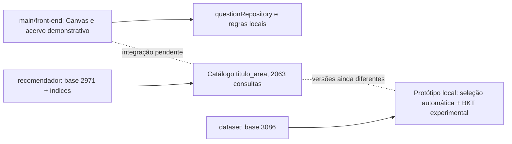
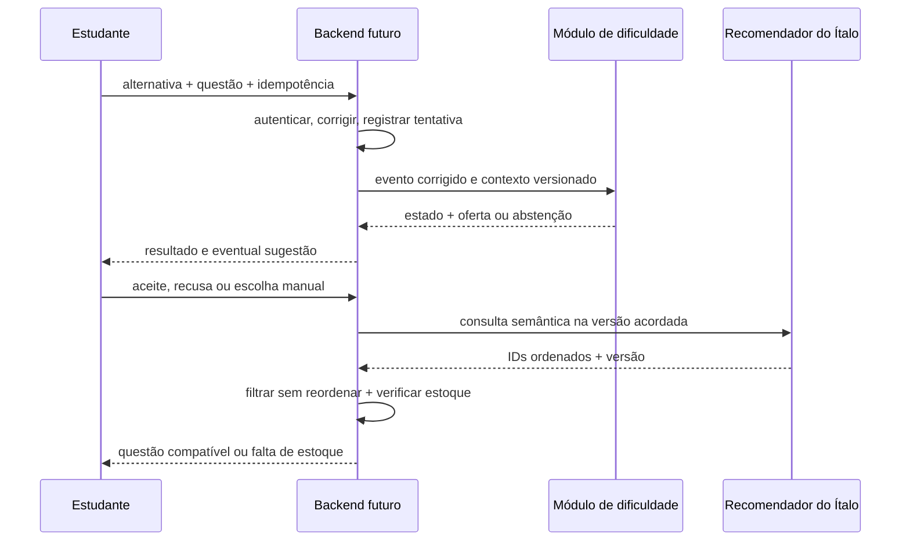

# Gabaritei — preparação da integração entre dificuldade e recomendação de questões

13/11/2026. Revisão técnica de arquitetura; integração ainda não implementada ou homologada.

## Escopo respeitado

Foram consultadas as árvores completas de oito branches permitidas e conferidos os respectivos hashes. A branch expressamente excluída pelo usuário foi encontrada no remoto com a grafia **joao/recomendador-dificulade**. Seu conteúdo, seus arquivos e seu histórico não foram abertos, baixados, comparados ou analisados. A variante informada na mensagem, joao/recomendador-dificuldade, também está registrada como proibida no escopo. Somente o nome foi observado na listagem pública de branches para aplicar a exclusão.

Nenhum commit, push, merge ou PR. Nenhuma publicação, treinamento, recodificação de embeddings ou execução de juiz LLM. Esta revisão acontece depois dos testes do catálogo completo e não autoriza avanço para as fases futuras do produto.

## Revisões conferidas

| Branch permitida | Commit | Arquivos | Fontes de código na árvore |
|---|---|---:|---:|
| dataset | `67a5036b2297c7c2e78b1f011219ca112977d7a5` | 202 | 128 |
| dificuldade-adaptativa | `e00f20c0d534a2bdd1a845d71cb791a16e3f4212` | 178 | 132 |
| front-end | `1ada7f3a2e5f1d80fc9d5c9e08df4aaf2a52c461` | 85 | 64 |
| main | `90d54984c21982c89e0d645ecfa78b1442b813b9` | 78 | 58 |
| paridade-p1 | `50060d0f5ff8494226905c2b0c023c84214983a7` | 298 | 128 |
| recomendador | `a7b5b8c9ae8c153c04956d2e1ac3dcdada6a41ef` | 398 | 181 |
| recomendador-para-main | `f9ca200ac92c41c70b13eb9db57f35c8a7972e76` | 303 | 111 |
| wardrobe | `ea3f28d22f805dea191e12130e14a3034099cf43` | 35 | 6 |

As árvores de código permitidas coincidem com os blobs da auditoria anterior: zero arquivos de código novos ou modificados nessas branches em relação ao inventário de12/11. A revisão reutilizou aquela leitura estrutural e examinou novamente os pontos de integração. A mudança do dataset é de conteúdo/documentação, não nova implementação de backend. O levantamento cobre todas as árvores permitidas, mas não é certificação humana linha a linha de todo código. Evidências emsnapshot_permitido.json,escopo.json,compatibilidade.json e no pacote de auditoria anterior.

## Como o projeto funciona hoje

### main e front-end

São o frontendCanvas comHTML/CSS/JS. O learning-engine.ts recompõe módulos delegacy/src; a versão compilada vai paraassets/learning-engine.js. O acervo demonstrativo tem254questões autorais, confirmado nos testes anteriores, e a persistência élocalStorage. Os fluxos de prática/histórico/estatísticas usam esse acervo. O servidorserver.mjsé estático, local, não umaAPI de correção, autenticação ou BKT.

O contratoQuestionRepositorytemall/getById/getMany/query/searche é um ponto útil para entrada de catálogo real. Entretanto, não basta trocar apenas esse repositório: reducers.ts importaQUESTION_BY_IDdiretamente e compara a alternativa aoq.correctno navegador. Há outros consumidores dosfixtures que precisam ser inventariados antes da troca. Esse desenho é coerente com um protótipo local, mas precisa de correção autorizada no servidor para uma integração real confiável.

### recomendador e recomendador-para-main

O módulo deÍtalo fica emrecomendador/rrf-tfidf-minilm-J. A implementação permite modosTF-IDF,MiniLM,RRF,Qwen,árvore,título e titulo_area. O método oficial documentado é **titulo_area**: mesma matéria e título amplo, sem defeitos/duplicatas, preservando língua estrangeira e usando a receita de ordenação por matéria. Tem umaAPI Python/CLI e um catálogoJSONpré-calculado; não foi identificado serviçoHTTPde produção que já exponha esse fluxo.

Indicecarregaquestions.jsonl,documentos.json,TF-IDF,MiniLM,opcionalmenteQwen,e rótulos da árvore. Verifica o hash da própria base e o alinhamento esperado dos vetoresQwen. O catálogo trazrecomendacoesporIDe metadadosquestoes. O nível no catálogo é uma classificação do item por tercis de b por área; isso ainda não é escolha adaptativa para o aluno. Não se deve alterar a ordem semântica deÍtalo ao filtrar o nível.

recomendador-para-mainé uma branch de preparação, não sinal de que a integração ocorreu. Os arquivos e a base lidos são compatíveis com sua própria revisão, não automaticamente com o dataset atualizado.

### dificuldade-adaptativa

NoGitHubessa branch ainda contém apenas os nove arquivos da auditoria históricaFase1. O motorBKT e o protótipo de catálogo completo estão nas entregas locais; não foram publicados automaticamente. O preparadorFase1fixa a base2971por hash, comportamento correto para reproduzir os testes antigos. Não é um carregador genérico do novo catálogo.

### dataset, paridade-p1 e wardrobe

datasettêm a base atual3.086e2.563textuais. paridade-p1é trabalho visual sobre o frontendNext.js histórico; não deve ser sobrescrito pela integraçãoCanvas. wardroberetém versões antigas e o pipeline de dados unificados; não deve ser integrado inteiro àmain. O frontendNextnas branches antigas tem contratoEnvioResposta/Correcaoe clienteHTTPindisponível; esse contrato não equivale automaticamente ao motorCanvas atual.

## Principal incompatibilidade: versão dos dados

| Medida | Resultado real |
|---|---:|
| Catálogo bruto deÍtalo | 2.971 |
| Catálogo bruto atual | 3.086 |
| IDs brutos em comum | 2.962 |
| Novos IDs brutos | 124 |
| IDs brutos removidos | 9 |
| Elegíveis do índice antigo | 2.063 |
| Elegíveis textuais atuais | 2.563 |
| Elegíveis em comum | 2.049 |
| Elegíveis atuais ausentes do índice antigo | **514** |
| Elegíveis antigos que deixaram a lista atual | 14 |

NosIDscomuns mudaram690enunciados e59conjuntos de alternativas,1área e455flagsready_text. Gabarito,habilidade,TRIe família de conteúdo não mudaram nessesIDs. A alteração de enunciado pode ser formatação, transcrição ou conteúdo: não foi classificada semanticamente em690casos; o total não significa690erros de embedding comprovados. Mesmo assim, um hash novo precisa ser conciliado antes de afirmar alinhamento entre textos e vetores.

-Base semântica:a64f75300b2e7f42bf7ea9c61748c54086b1b53a558a4d5e2f171f8da8005760.
-Base atual:fedeb342679287d5a68cd3f7703b6aa4e610559b3e26358ab3098cea1f8b826b.
-Ocatálogotitulo_areacorresponde à base antiga própria, mas não à base atual.

O estado para uso direto conjunto é **BLOQUEADO_POR_DIVERGENCIA_DE_VERSAO**. Isso não impede desenhar contratos ou testar componentes locais. A atualização futura dos índices, rótulos e catálogo deve ter autorização, revisão de diferenças, novas versões e avaliação apropriada; não foi feita nesta execução.

## Segunda incompatibilidade: significado da faixa

Ítalousa tercis de b **por área no treino** e operadores<nos limites. A nossa demonstração atual usa faixas relativas **dentro de ano/prova/área** e ordenação por posições em tercis locais. “Fácil” nas duas versões não significa necessariamente o mesmo conjunto de questões.

Antes de filtrar uma lista semântica, o integrador deve exigir a mesma versão de catálogo e uma versão explícita de faixa/escala. Deve receber b e a chave de escala de cada item. Não converter percentualBKTemb, não comparar escalas diferentes sem evidência e não reinterpretar silenciosamente o campo nivel antigo como faixa local nova.

## Terceira incompatibilidade: taxonomia e formato do frontend

| Campo | Dataset/módulo | Canvas atual | Tratamento necessário |
|---|---|---|---|
| Área | MT,LC,CH,CN | matematica,linguagens,humanas,natureza | Mapeamento direto documentado |
| ID | gq_… | IDs defixtures | Manter IDs oficiais estáveis; não inventar remapeamento sem tabela |
| Faixa | versão local ou catálogo por área | facil/media/dificil | Mesma grafia não prova mesma escala; incluir versão |
| Alternativas | label/text | letter/text | Adaptador mecânico, preservando ordem e texto |
| Matéria/assunto | metadados incompletos/não certificados | subjectId/topicId obrigatórios | Mapear apenas com rótulos confiáveis ou adaptar tipo para desconhecido |
| Habilidade | código pode estar ausente | skilltexto | Não inventar descrição ou domínio de habilidade |
| Gabarito | answer | correctno cliente | Correção futura autorizada no servidor; retorno após tentativa |
| Resolução | não há explicação supervisionada para todos | explanationobrigatória | Estado“resolução não cadastrada”, sem gerar falsa explicação |
| Língua | pt/en/es | ingles/espanhol | Mapeamento explícito e filtro sem misturar escolhas |

## Contrato proposto — ainda não implementado

O arquivoCONTRATO_RASCUNHO.jsonregistra os envelopes. É proposta para revisão da equipe, não umaAPI já disponível.

1.**Identidade e versão:** dataset_sha256,question_id,content_family_id,area,language,tri_scale_id,difficulty_scheme_versione model_version acompanham as operações. Rejeitar hash incompatível antes de selecionar qualquer item.
2.**Tentativa corrigida:** o futurobackend autentica, recebe a letra, produzcorrecte umattempt_idcanônico, mantém chave de idempotência e ordena eventos por aluno/escopo. O navegador não informa a verdade do acerto.
3.**Decisão de dificuldade:** o módulo recebe contexto e histórico, atualiza estado e retorna escolha atual, eventual oferta, motivos e limites de evidência. ENEMsem calibração deve ficar explicitamenteexperimental/fallback, sem domínio certificado.
4.**Candidatas semânticas:**Ítaloretorna IDs em ordem, com método e hash do catálogo. O integrador filtra conteúdo válido, área/língua, repetição de ID/família, escala e faixa aceita **mantendo a ordem original**. Não reordenar porbpara desfazer a relevância semântica.
5.**Estoque e consentimento:** contar o estoque depois da interseção dos filtros. Sem itens, retornarestado sem_candidatos_no_nivel_escolhidoe opções explícitas. Não trocar faixa, ampliar assunto ou misturar escala silenciosamente.
6.**Entrega de questão:** retornar enunciado/alternativas/metadados públicos, sem gabarito antecipado. Registrar o que foi servido, versão, faixa escolhida, motivo, origem semântica e oferta aceita. O histórico completo precisa permitir separar repetição de aprendizagem.

## Projeção estrutural de estoque

Para revelar um risco de contrato, foi feita uma projeção apenas sobreIDsdo ranking congelado: entre2.029consultas que ainda existem e têm faixa local,384não mantêm nenhuma candidata na mesma escala; a mediana é2candidatas na escala. Das6.087oportunidadesconsulta×faixa,1.182não têm candidata fácil,1.117não têm média e1.148não têm difícil.

**Essa projeção usa um ranking antigo com hash diferente e não aprova seu uso na base nova.** Não é teste de precisão, aprendizagem ou simulação de trajetória. Serve apenas para mostrar por que o estoque do catálogo inteiro não é o estoque de um mesmo título+escala+faixa. A projeção real precisa ser refeita após alinhar o catálogo semântico. Resultados porconsulta emprojecao_estoque_por_query.json.

## Sequência de trabalho recomendada para a equipe revisar

1.Acordar uma revisão única de dados e uma semântica de dificuldade versionada; manter as revisões históricas intactas.
2.Conciliar IDs/rótulos e decidir como atualizar as514questões textuais ainda não indexadas e os textos modificados. Atualizações de modelos/representações dependem de autorização específica.
3.Definir o contrato de questões reais doCanvas, incluindo metadados desconhecidos e resoluções ausentes. Trocar o repositório e os acessos diretos aosfixtures de forma coordenada.
4.Preparar a camada debackend para identidade, correção, idempotência, eventos, versões e consentimento, sem expor gabarito antecipadamente.
5.Criar um adaptador de dificuldade independente de seleção semântica, com modoexperimental/fallback claramente indicado noENEM.
6.Testar a interseção das candidatas reais deÍtalo com área/língua/família/escala/faixa. Planejar a experiência de falta de estoque com escolha do aluno.
7.Somente depois executar teste ponta a ponta e um piloto real autorizado; isso não é feito automaticamente por esta auditoria.

## Critérios de aceitação para futura integração

-Catálogo, índices e serviço apontam para o mesmoSHAe IDs; nenhuma questão nova é ignorada sem registro.
-Texto, alternativa, gabarito eTRImantidos; metadados ausentes não são inventados.
-Ordem semântica preservada entre as candidatas restantes.
-Tentativa duplicada não atualizaBKTduas vezes; pergunta/família repetida é tratada separadamente da idempotência técnica.
-Aceite explícito precede a troca de preferência; oferta vencida/outro aluno é rejeitada.
-Estoque real calculado após todos os filtros; zero substituições silenciosas de faixa/escala/assunto.
-Registros completos e versionados para avaliar comportamento ao longo do tempo.
-Fallback/experimentoENEMnão apresentado como domínio validado ou aprendizado contínuo global já implementado.

## Conclusão para Gabriel e Ítalo

O catálogo completo já pode alimentar uma seleção automática local, conforme o pacote de testes entregue. A integração comÍtalodepende principalmente de alinhar versões, faixas, formatos e estoque, e de criar obackend que hoje não liga esses componentes. A preparação está documentada; a integração real ainda não foi executada. A branch excluída permaneceu fora da revisão.

## Fontes primárias

-[main/learning-engine.ts](https://github.com/italodsz/Gabaritei---PI-VI/blob/90d54984c21982c89e0d645ecfa78b1442b813b9/frontend/learning-engine.ts)
-[Contrato de questões Canvas](https://github.com/italodsz/Gabaritei---PI-VI/blob/90d54984c21982c89e0d645ecfa78b1442b813b9/frontend/legacy/src/types/content.ts)
-[Repositório de questões Canvas](https://github.com/italodsz/Gabaritei---PI-VI/blob/90d54984c21982c89e0d645ecfa78b1442b813b9/frontend/legacy/src/lib/repositories/questionRepository.ts)
-[Reducers e correção local](https://github.com/italodsz/Gabaritei---PI-VI/blob/90d54984c21982c89e0d645ecfa78b1442b813b9/frontend/legacy/src/lib/sessions/reducers.ts)
-[Motor de recuperação deÍtalo](https://github.com/italodsz/Gabaritei---PI-VI/blob/a7b5b8c9ae8c153c04956d2e1ac3dcdada6a41ef/recomendador/rrf-tfidf-minilm-J/recomendador.py)
-[Catálogo e estado da integração](https://github.com/italodsz/Gabaritei---PI-VI/blob/a7b5b8c9ae8c153c04956d2e1ac3dcdada6a41ef/recomendador/rrf-tfidf-minilm-J/catalogo/LEIA.md)
-[Dataset utilizado nesta rodada](https://github.com/italodsz/Gabaritei---PI-VI/tree/67a5036b2297c7c2e78b1f011219ca112977d7a5/Dataset/base_trabalho)
